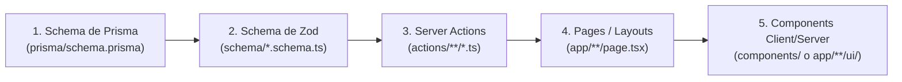

# AGENTS.md — Reglas y Directivas para Agentes de IA

Este documento define la filosofía de desarrollo, la arquitectura y las reglas estrictas que **Antigravity** (y cualquier agente de IA) debe seguir en este repositorio (**invitaciones**).

---

## 1. Filosofía Central: "Lazy Senior Developer" (Ponytail)

> **"El mejor código es el que no se escribe."**  
> Ser *lazy* significa ser **eficiente**, no descuidado. Menos código, menos mantenimiento, menos bugs.

Antes de escribir cualquier línea de código, evalúa en este orden:
1. **¿Es realmente necesario? (YAGNI)**: Si no fue solicitado explícitamente, no lo construyas.
2. **¿Lo resuelve la Standard Library o APIs nativas del navegador/Next.js?**: Úsalas antes de inventar lógica.
3. **¿Ya existe una dependencia instalada en el proyecto?**: Reutilízala antes de sugerir paquetes nuevos (Tailwind, Lucide React, Zod, Prisma, NextAuth).
4. **¿Cabe en una línea limpia?**: Déjalo en una línea.
5. **Solo entonces**: Escribe el código mínimo indispensable que funcione con la máxima calidad visual.

### Reglas de Simplicidad:
- **Cero abstracciones no solicitadas**: No crees capas intermedias, factories o wrappers genéricos sin necesidad.
- **Sin boilerplate innecesario**: Soluciones directas, legibles y mantenibles.
- **Eliminar > Añadir**: Prefiere código simple y directo antes que estructuras complejas sobre-ingenierizadas.
- **Comentarios de Simplificación**: Si aplicas un atajo intencional con un límite conocido, márcalo con:  
  `// ponytail: [descripción del límite y ruta de actualización si se escala]`.

### Lo que NO es negociable (No-Lazy):
- **Validación estricta de entradas** en los límites de confianza (Zod).
- **Manejo robusto de errores** en Server Actions y mutaciones de base de datos.
- **Seguridad en rutas privadas**: Proteger `/app` con la sesión de NextAuth (`auth()`).
- **Línea de diseño y estética premium**: Textura de papel, tipografía, microanimaciones y armonía visual.
- **Accesibilidad y responsividad Mobile-First**: Las invitaciones se abren principalmente en smartphones.
- **Verificación ejecutable**: Todo cambio no trivial debe verificarse (mínimo compilación con `npx tsc --noEmit`).

---

## 2. Estructura de Directorios (Sin `src/`)

Este proyecto utiliza Next.js App Router en la raíz (sin carpeta `src/`):

```text
invitaciones/
├── actions/             # Server Actions ('use server')
│   ├── auth/            # login, logout
│   └── message/         # createUpdateMessage, getPaginatedMessages, deleteMessage
├── app/                 # Rutas y páginas de Next.js
│   ├── (public)/        # Landing e invitación pública (app/page.tsx)
│   ├── app/             # Panel privado de administración de mensajes
│   ├── auth/            # Pantalla de login de organizador/admin
│   └── api/             # API routes (ej. NextAuth handlers)
├── auth.config.ts       # Configuración de NextAuth v5
├── components/          # Componentes reutilizables e invitaciones
├── interfaces/          # Tipos y contratos TypeScript (paginación, respuestas)
├── lib/                 # Singletons y clientes (prisma.ts, utils.ts)
├── prisma/              # Schema de base de datos PostgreSQL (schema.prisma)
├── public/              # Assets estáticos (imágenes, texturas, música)
└── schema/              # Validaciones y schemas con Zod
```

---

## 3. Flujo Estricto de Desarrollo

Siempre que se desarrolle una funcionalidad o se modifique una entidad, sigue este orden secuencial:



---

## 4. Directivas por Capa de la Arquitectura

### 4.1. Prisma (`prisma/schema.prisma`)
- **Modelos Claros**: Nombres descriptivos en singular (`Message`, `User`).
- **Timestamps**: Incluir siempre `createdAt DateTime @default(now())` y `updatedAt DateTime @updatedAt`.
- **Integridad Referencial**: Definir reglas de eliminación explícitas (`onDelete: Cascade` o `SetNull`) si se agregan relaciones.
- > [!WARNING]
  > **MIGRACIONES**: El usuario ejecuta las migraciones de Prisma. **NUNCA** ejecutar comandos de migración (`npx prisma migrate ...`, `npx prisma db push`) ni `npx prisma validate` sin permiso explícito.

---

### 4.2. Schemas y Validaciones con Zod (`schema/`)
- **Ubicación**: Todo modelo o formulario debe tener su esquema de validación en `schema/[modulo].schema.ts`.
- **Exportación de Tipos**: Exportar siempre el esquema y su tipo inferido:
  ```typescript
  import { z } from "zod";

  export const messageSchema = z.object({
    id: z.number().optional(),
    name: z.string().min(1, "El nombre es requerido"),
    content: z.string().min(1, "El mensaje es requerido"),
  });

  export type MessageInput = z.infer<typeof messageSchema>;
  ```
- **Barrel Export**: Exportar los esquemas en `schema/index.ts`.

---

### 4.3. Server Actions (`actions/`)
- **Directiva Obligatoria**: Incluir siempre `'use server';` en la primera línea.
- **Validación Zod**: Validar todos los argumentos con `schema.safeParse(data)` antes de cualquier operación en la base de datos.
- **Sesión en Acciones Privadas**: Validar la sesión con `auth()` en acciones administrativas (ej. eliminar mensajes o ver datos privados).
- **Respuesta Estandarizada**: Retornar siempre un objeto estructurado:
  ```typescript
  export type ActionResponse<T = unknown> = {
    ok: boolean;
    message: string;
    data?: T;
  };
  ```

---

### 4.4. Páginas y Routing (`app/`)
- **Invitación Pública (`app/page.tsx`)**:
  - Vista principal para los invitados (detalles del evento, cuenta regresiva, mapa, itinerario, reproductor de música y formulario de confirmación RSVP).
- **Panel Privado (`app/app/page.tsx`)**:
  - Server Component protegido: verifica `const session = await auth()`; si no hay sesión, redirige con `redirect('/auth')`.
  - Carga inicial de datos desde el servidor mediante Server Actions.
- **Autenticación (`app/auth/page.tsx`)**:
  - Formulario de login adaptado al estilo visual del evento para que el anfitrión acceda a su buzón.

---

### 4.5. Componentes y UI (`components/` o `app/**/ui/`)
- **Separación de Responsabilidades**: Usar `'use client';` únicamente en componentes con interactividad, modales, reproducción de audio, scroll reveal o estado local.
- **Formularios**:
  - Validar datos antes de enviar.
  - Mostrar feedback visual inmediato (`isSubmitting` / `isPending`), spinners y mensajes de éxito/error.
- **Empty States**: Cuando no existan registros (ej. sin mensajes aún), mostrar un estado visual amigable con icono y explicación clara.

---

## 5. Diseño Visual y Experiencia de Usuario (UX)

- **Línea Estética Central**:
  - Textura de papel arrugado artesanal (`crumpled-paper-texture`, `paper-wrinkle-overlay`).
  - Tipografías personalizadas (`maliatons` para títulos destacados y sans-serif legible para textos de lectura).
  - Elementos decorativos festivos (banderillas superiores `/img/up.png`, estrellas doradas flotantes animadas `/img/star-1.png`, `/img/star2.png`).
  - Paleta cálida, suave y elegante (tonos beige, marfil, toques de rosa, oro y obsidiana).
- **Enfoque Mobile-First**: La inmensa mayoría de los invitados abrirán el enlace desde WhatsApp en teléfonos móviles. Asegurar que los botones, tarjetas y modales tengan tamaños cómodos al tacto (mínimo 44px de área de tap).
- **Microinteracciones**: Efectos hover suaves, transiciones al desplegar modales, feedback al copiar enlaces/ubicación y scroll reveal progresivo.

---

## 6. Estándares de Código y TypeScript

- **Tipado Estricto**: Cero uso de `any` arbitrario. Tipar retornos, props y parámetros explícitamente.
- **Interfaces Centralizadas**: Mantener contratos y DTOs en `interfaces/[modulo].interface.ts`.
- **Verificación Obligatoria**:
  > [!IMPORTANT]
  > Antes de dar por concluida cualquier tarea, valida la compilación ejecutando:
  > ```bash
  > npx tsc --noEmit
  > ```