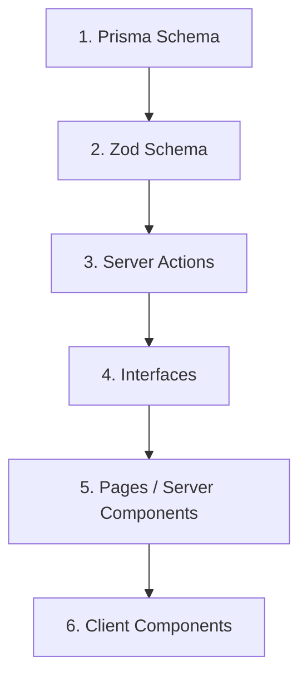

# AGENTS.md

## 1. Objetivo y reglas generales

Este documento establece las reglas obligatorias de desarrollo del proyecto. Antes de implementar una funcionalidad, revisar la arquitectura, los modelos, las interfaces, las acciones y las utilidades existentes. Mantener las convenciones actuales y evitar introducir patrones, dependencias o abstracciones innecesarias.

- Aplicar DRY, KISS, separación de responsabilidades y mínimo código necesario (lazy code, sin sobreingeniería).
- Antes de corregir o implementar, analizar el estado actual: identificar causa raíz o necesidad, revisar consumidores, contratos y utilidades existentes, y elegir la solución funcional más corta y mantenible.
- Preferir inferencia, funciones existentes y cambios localizados antes que nuevas abstracciones. No confundir menor código con omitir validaciones, seguridad o manejo de errores.
- No duplicar lógica ni modificar funcionalidades ajenas al requerimiento.
- No instalar dependencias ni realizar cambios destructivos sin autorización.
- Utilizar Next.js App Router, TypeScript estricto, Prisma, PostgreSQL, Zod, Tailwind CSS, shadcn/ui y Lucide.

## 2. Flujo estricto de desarrollo



Respetar este orden al desarrollar funcionalidades. Si una etapa necesita un contrato compartido, definir o reutilizar su interfaz antes de implementar el código que la consume. No modificar el schema de Prisma si la funcionalidad no lo requiere.

### 2.1. Prisma — `prisma/schema.prisma`

- Prisma es la fuente de verdad de las entidades, enums y relaciones persistidas.
- Definir nombres explícitos, restricciones, índices y relaciones coherentes con el dominio.
- Establecer reglas de eliminación según el dominio (`Cascade`, `SetNull` o `Restrict`). No aplicar eliminaciones en cascada indiscriminadamente.
- Agregar `isActive` a entidades que requieran desactivación sin perder su historial o relaciones.
- El usuario ejecuta las migraciones. No ejecutar `prisma migrate`, `prisma db push`, `prisma migrate reset`, `prisma generate` ni `npx prisma validate` sin autorización explícita.
- No modificar migraciones previamente aplicadas ni eliminar datos.

### 2.2. Zod — `schema/*.schema.ts`

- Toda entrada externa de una Server Action debe contar con validación Zod, incluidos identificadores, filtros y parámetros de paginación.
- Centralizar los schemas en `schema/` y reutilizarlos tanto en formularios como en acciones.
- Exportar mediante `schema/index.ts` siguiendo la convención existente.
- Inferir los tipos de entrada con `z.input` y de salida con `z.output` o `z.infer`, según corresponda. No duplicar manualmente los campos de un schema.
- Diferenciar los datos de un formulario de los modelos persistidos de Prisma.
- No confiar únicamente en la validación del cliente.

### 2.3. Server Actions — `actions/**/*.ts`

- Declarar las acciones con `'use server'`.
- Validar los argumentos con `safeParse` antes de operar sobre la base de datos. Usar `unknown` para entradas no confiables cuando corresponda.
- Validar sesión con `auth()` y permisos, propiedad y alcance de los recursos cuando aplique. No confiar en identificadores de usuario o pertenencia enviados por el cliente.
- Mantener el acceso a Prisma y la lógica de negocio del lado del servidor.
- Usar `prisma.$transaction` para operaciones que requieran atomicidad.
- Registrar auditoría cuando exista el mecanismo correspondiente y la operación lo requiera.
- En mutaciones, retornar una respuesta estructurada con `ok`, `message` y `data` cuando corresponda; reutilizar el contrato existente o dejar que TypeScript infiera la respuesta si no necesita un contrato explícito.
- En consultas paginadas, respetar el contrato de `PaginatedComponentProps<T>` de `interfaces/pagination.interface.ts`. No envolver ni transformar las respuestas innecesariamente si el proyecto ya tiene una convención.
- Manejar errores con `try/catch`, sin exponer detalles internos, credenciales ni información sensible.
- Ejecutar `revalidatePath()` en todas las acciones de mutación exitosas, para cada ruta afectada, después de confirmar la operación. Las acciones de lectura no deben invalidar caché sin motivo.
- Nunca usar `router.refresh()` como sustituto de la revalidación.
- No devolver contraseñas, hashes, tokens privados ni campos innecesarios. Usar `select` cuando corresponda.

### 2.4. Interfaces — `interfaces/*.interface.ts`

- Revisar las interfaces existentes antes de crear una nueva.
- Importar modelos y enums desde el cliente generado de Prisma según la configuración del proyecto.
- No redeclarar interfaces que sean idénticas a un modelo de Prisma.
- Extender los modelos únicamente cuando se requieran relaciones, campos calculados o contratos específicos.
- Usar nombres explícitos como `IUserExtended` o `IMessageExtended` para extensiones, siguiendo la convención existente.
- Las interfaces deben reflejar exactamente los datos devueltos por `select` o `include`. Usar `Pick`, `Omit` o `Prisma.ModelGetPayload` cuando corresponda, sin simular que una consulta parcial devuelve el modelo completo.
- Centralizar contratos compartidos de respuestas, paginación, filtros y propiedades reutilizables. Evitar interfaces duplicadas y exportaciones circulares.

### 2.5. Pages y Server Components — `app/`

- Los componentes son Server Components por defecto.
- Realizar la carga inicial de datos en el `page.tsx` o Server Component responsable, mediante las acciones de lectura correspondientes.
- Ejecutar consultas independientes en paralelo con `Promise.all`.
- Resolver `params` y `searchParams` de acuerdo con la versión instalada de Next.js.
- Mantener páginas y layouts simples; delegar presentación y lógica a componentes especializados.
- Pasar a los Client Components únicamente datos necesarios, serializables y correctamente tipados.
- No utilizar `Suspense` como solución automática. Respetar la configuración de renderizado existente.

### 2.6. Client Components

- Utilizar `'use client'` únicamente cuando se necesiten hooks, eventos, estado o APIs del navegador.
- Mantener los límites cliente-servidor lo más pequeños posible.
- Usar React Hook Form y `@hookform/resolvers/zod` para formularios.
- Reutilizar los schemas de Zod y las interfaces compartidas.
- Usar `sonner` para notificaciones de éxito y error.
- Gestionar estados de carga y prevenir envíos duplicados.
- No repetir el fetching inicial en `useEffect` si los datos ya se obtuvieron desde el servidor.
- No acceder directamente a Prisma ni importar módulos exclusivos del servidor.

## 3. TypeScript: reglas obligatorias

### 3.1. Prohibición absoluta de `any`

- No utilizar `any`, `any[]`, `as any`, `Promise<any>`, `Record<string, any>` ni genéricos con `any`.
- No introducir `@ts-ignore`, `@ts-nocheck` ni conversiones forzadas para ocultar errores de tipado.
- Usar `unknown` y realizar narrowing cuando no se conozca la estructura de una entrada o error.
- No desactivar `strict` ni `noImplicitAny`.
- Aprovechar la inferencia de TypeScript cuando el tipo ya sea evidente.

### 3.2. Interfaces antes que aliases

- Preferir `interface` para objetos, props, contratos, respuestas y extensiones.
- No usar `type` cuando el mismo contrato pueda expresarse correctamente con una `interface`.
- Se permite `type` únicamente cuando sea necesario: inferencias Zod, uniones, tipos condicionales, mapped types u otros casos que no puedan expresarse directamente mediante interfaces.
- Preferir imports normales (`import { User, Clinic } from "@prisma/client"`) según la convención del proyecto. No imponer `import type`; utilizarlo cuando la configuración de TypeScript lo exija (por ejemplo, `verbatimModuleSyntax`) o sea necesario para mantener los límites servidor/cliente.

Ejemplos orientativos (adaptar nombres y ruta de importación al cliente Prisma existente):

```ts
import { User, Clinic } from "@prisma/client";

export interface IUserExtended extends User {
    clinic?: Clinic | null;
    doctor?: User | null;
}
```

Este ejemplo ilustra la convención de extensión, no obliga a crear esas relaciones en el proyecto. Usar propiedades opcionales cuando la relación pueda no haberse consultado y `null` cuando Prisma pueda devolver una relación ausente. Si siempre se incluye, no marcarla como opcional innecesariamente.

Para una consulta parcial, usar un contrato que represente los campos realmente seleccionados. No crear extensiones que obliguen a devolver información sensible.

```ts
import { z } from 'zod';

export const userIdSchema = z.object({
    id: z.number().int().positive(),
});

// Excepción válida: tipo inferido de Zod.
export type UserIdInput = z.infer<typeof userIdSchema>;
```

## 4. Revalidación, navegación y URL

### 4.1. Revalidación

- Prohibido `router.refresh()` en todo el proyecto.
- Cada Server Action que modifique datos debe revalidar las rutas afectadas con `revalidatePath()` tras una mutación exitosa.
- No revalidar rutas globales innecesariamente ni revalidar después de operaciones fallidas.
- `router.push()` y `router.replace()` están permitidos para navegación, no como mecanismos artificiales de actualización.

### 4.2. Parámetros de URL — `utils/updateUrl.ts`

- Centralizar la incorporación, actualización y eliminación de parámetros de búsqueda en `updateUrl`.
- Reutilizar esta utilidad para filtros, búsquedas, paginación, ordenamiento y otros estados que deban persistir en la URL.
- Respetar la firma existente de `updateUrl`. No crear implementaciones alternativas dentro de componentes.
- Preservar parámetros no relacionados y eliminar parámetros vacíos cuando corresponda.
- Reiniciar la página al cambiar filtros o búsquedas que alteren el conjunto de resultados.
- Evitar duplicar en estado local información que ya tenga la URL como fuente de verdad, salvo estados transitorios de edición.

## 5. Paginación y búsqueda

- Reutilizar `PaginationProps`, `ISearchParams`, `PaginatedComponentProps<T>` y `UpdateURLParams` desde `interfaces/pagination.interface.ts`; extenderlas únicamente cuando sea necesario.
- La paginación de entidades principales debe resolverse desde el `page.tsx` mediante `searchParams` y una Server Action paginada.
- Validar página, límite, filtros y ordenamiento en el servidor.
- Aplicar `skip`, `take`, `where` y un orden determinista en Prisma. Usar los mismos filtros para la consulta de resultados y el conteo.
- No cargar todos los registros para paginarlos en el navegador.
- Cargar relaciones necesarias desde el servidor. Si un formulario requiere búsquedas dinámicas de relaciones, utilizar una acción de lectura desde el componente con debounce y control de respuestas obsoletas cuando aplique.
- No duplicar componentes ni interfaces de paginación.

### 5.1. Contratos centralizados — `interfaces/pagination.interface.ts`

Conservar las interfaces existentes y reutilizar sus campos. Esta referencia recoge las convenciones de trabajo; no sobrescribir el archivo real ni incorporar filtros de otros dominios que no se necesiten.

```ts
export interface PaginationProps {
    page?: number;
    take?: number;
    search?: string;
    startDate?: string;
    endDate?: string;
    categoryId?: number;
    isActive?: boolean;
    role?: string;
}

export interface ISearchParams {
    page?: string;
    take?: string;
    search?: string;
    startDate?: string;
    endDate?: string;
    role?: string;
    gender?: string;
    status?: string;
    userId?: string;
    fundPage?: string;
    token?: string;
    reset?: string;
    set?: string;
    redirect?: string;
    showInactive?: string;
    tab?: string;
    month?: string;
}

export interface PaginatedComponentProps<T> {
    data: T[];
    total: number;
    totalPages: number;
    page?: number;
    take?: number;
    search?: string;
    isAdmin?: boolean;
}

export interface UpdateURLParams {
    startDate?: string;
    endDate?: string;
    page?: number;
    take?: number;
    search?: string;
    status?: string;
    role?: string | number;
    year?: number | string;
    month?: number | string;
    [key: string]: string | number | boolean | null | undefined;
}
```

- `ISearchParams`: parámetros de URL recibidos por la página, antes de convertir y validar sus valores.
- `PaginationProps`: argumentos tipados de las acciones paginadas, después de interpretar los parámetros de URL.
- `PaginatedComponentProps<T>`: contrato compartido para resultados paginados y props de componentes. `T` debe ser el modelo Prisma correspondiente o su extensión cuando aplique. `total` representa todos los registros que coinciden con los filtros, no solo los de la página actual.
- `UpdateURLParams`: argumentos de la utilidad `updateUrl`. La firma de índice admite únicamente valores escalares compatibles con parámetros de URL; convertirlos explícitamente a texto y manejar `null`/`undefined` según la convención existente.
- No crear una interfaz de paginación por entidad. Si un dominio requiere filtros adicionales, extender el contrato existente o agregar campos compartidos cuando corresponda.
- No introducir una interfaz genérica de respuesta adicional si las interfaces existentes y la inferencia de TypeScript resuelven el caso.
- `isAdmin` sirve para presentación; nunca sustituye la autorización en el servidor.

## 6. Fechas — `utils/format-date.ts`

- Centralizar el parseo, formateo, conversión y manejo de zonas horarias en `format-date`.
- Revisar las funciones existentes antes de agregar otra. No duplicar lógica de fechas en acciones, páginas o componentes.
- Guardar instantes en UTC y convertirlos a la zona horaria de negocio al presentar o interpretar fechas locales.
- Distinguir fechas de calendario, horas locales e instantes absolutos. No tratar una fecha sin hora como si fuera necesariamente un instante UTC.
- No aplicar desfases manuales fijos ni depender de la zona horaria del navegador o servidor.
- Usar la zona horaria configurada por el proyecto; no introducir una distinta sin autorización.

## 7. UI y experiencia de usuario

- Utilizar Tailwind CSS mediante `className`. No agregar estilos inline, etiquetas `<style>` ni scripts incrustados en componentes.
- Reutilizar los componentes de `components/ui/` (shadcn/ui) y los iconos de Lucide.
- Mantener la identidad visual, tokens y paleta definidos en `globals.css`.
- Diseñar mobile-first, con tablas en desktop y tarjetas en móvil cuando sea apropiado.
- Implementar estados vacíos, carga, error y confirmación de operaciones destructivas.
- Evitar badges, iconos y elementos decorativos repetitivos.
- Mantener accesibilidad: etiquetas de formularios, navegación por teclado, foco visible y contraste suficiente.
- No crear componentes genéricos innecesarios ni duplicar componentes existentes.

## 8. Seguridad y consistencia de datos

- Verificar autorización en el servidor para cada operación protegida, incluso si la UI oculta el acceso.
- Aplicar el alcance de usuario u organización según el modelo real del proyecto.
- No exponer secretos, variables privadas, hashes de contraseña ni tokens de sesión.
- Almacenar contraseñas mediante hashing seguro, nunca en texto plano.
- Validar existencia, propiedad y estado de las entidades relacionadas antes de mutaciones cuando corresponda.
- Utilizar restricciones de base de datos y transacciones para preservar integridad ante operaciones concurrentes.

## 9. Organización del proyecto

La siguiente estructura es orientativa. Respetar las carpetas y convenciones existentes; no reorganizar el repositorio sin autorización.

```text
app/                 # Rutas, páginas y layouts
prisma/              # Schema y migraciones
schema/              # Validaciones Zod
interfaces/          # Contratos TypeScript compartidos
actions/             # Server Actions por dominio
components/          # Componentes compartidos
  ui/                # Componentes base shadcn/ui
lib/                 # Configuración e integraciones
utils/               # Utilidades reutilizables
  updateUrl.ts       # Manejo de parámetros de URL
  format-date.ts     # Manejo de fechas
```

- Mantener archivos y funciones con una responsabilidad clara.
- Usar alias `@/` conforme a la configuración existente.
- No crear capas adicionales de repositorios, servicios o adaptadores si no resuelven una necesidad real del proyecto.
- Mantener la lógica de negocio fuera de la UI.

## 10. Validación antes de finalizar

Antes de entregar cualquier cambio:

- [ ] Analizar el estado previo, la causa o necesidad y comprobar que se eligió la solución más sencilla que cumple el requerimiento.
- [ ] Revisar que se respetó el flujo de desarrollo.
- [ ] No se introdujo `any` ni se ocultaron errores de TypeScript.
- [ ] Se reutilizaron modelos de Prisma, interfaces, schemas y utilidades existentes.
- [ ] Las entradas externas se validan con Zod y los permisos se verifican en el servidor.
- [ ] Las mutaciones revalidan las rutas afectadas y no se utiliza `router.refresh()`.
- [ ] Los parámetros de URL y fechas se gestionan mediante las utilidades centralizadas.
- [ ] No se introdujeron dependencias, duplicaciones o cambios ajenos innecesarios.
- [ ] La UI es responsiva y contempla estados relevantes.
- [ ] Ejecutar `npx tsc --noEmit` y el lint configurado en el proyecto. No ejecutar comandos que requieran instalar paquetes sin autorización.
- [ ] Informar al usuario de errores pendientes, validaciones no ejecutadas y decisiones que requieran confirmación.

No afirmar que una implementación compila o funciona si no se realizaron las verificaciones correspondientes. Si la validación depende de regenerar Prisma o aplicar una migración, informar al usuario y esperar su autorización.

<!-- BEGIN:nextjs-agent-rules -->

## This is NOT the Next.js you know

This version has breaking changes — APIs, conventions, and file structure may all differ from your training data. Read the relevant guide in `node_modules/next/dist/docs/` (resolved from this file's directory; in monorepos the `next` package may not be visible from the repo root) before writing any code. Heed deprecation notices.

This block is written and re-added by `next dev` — verify at `node_modules/next/dist/server/lib/generate-agent-files.js`. Removing it from a diff only re-creates the uncommitted change; committing it with your work keeps the tree clean.

<!-- END:nextjs-agent-rules -->
